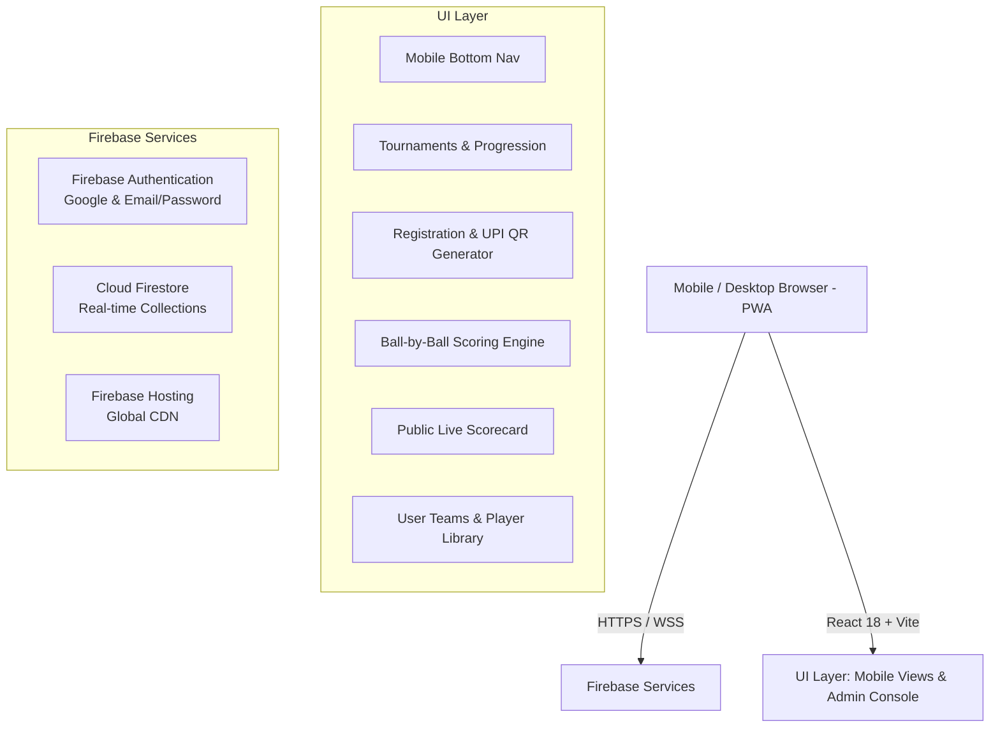

# 🏏 KMT Cricket Stadium — Platform & Matchday Management

> A high-performance, mobile-first Progressive Web App (PWA) designed for **KMT Cricket Stadium** (Vajralapuram). Built with **React 18**, **Vite**, **Firebase Authentication**, and **Cloud Firestore**, the platform powers end-to-end stadium operations: tournament creation, dynamic team registration with live UPI QR payments, visual bracket tournament progression, digital matchday passes, a live ball-by-ball scoring console, and public match scorecards.

---

## 📋 Table of Contents

- [Live URLs](#-live-urls)
- [Key Features](#-key-features)
  - [1. Mobile-First & PWA Experience](#1-mobile-first--pwa-experience)
  - [2. Stadium Discovery & Live GPS Navigation](#2-stadium-discovery--live-gps-navigation)
  - [3. Tournament Management & Custom Registration Fields](#3-tournament-management--custom-registration-fields)
  - [4. Dynamic UPI Payments & QR Code Integration](#4-dynamic-upi-payments--qr-code-integration)
  - [5. Digital Matchday Pass & Booking Status](#5-digital-matchday-pass--booking-status)
  - [6. Tournament Progress & Elimination Bracket Tracker](#6-tournament-progress--elimination-bracket-tracker)
  - [7. User Teams & Squad Library](#7-user-teams--squad-library)
  - [8. Real-Time Ball-by-Ball Live Scoring Console](#8-real-time-ball-by-ball-live-scoring-console)
  - [9. Cricbuzz-Grade Live Scorecard & Player Profile](#9-cricbuzz-grade-live-scorecard--player-profile)
  - [10. Admin Control Center & Approvals](#10-admin-control-center--approvals)
- [System Architecture & Tech Stack](#-system-architecture--tech-stack)
- [Firestore Data Schema](#-firestore-data-schema)
- [Security & Access Control](#-security--access-control)
- [Getting Started / Local Development](#-getting-started--local-development)
- [Testing](#-testing)
- [Deployment](#-deployment)

---

## 🌐 Live URLs

- **Production Web App:** [https://kmtstadium.web.app](https://kmtstadium.web.app)
- **Firebase Project Console:** [kmt-stadium-reg-20261023](https://console.firebase.google.com/project/kmt-stadium-reg-20261023/overview)
- **Stadium Location:** [Vajralapuram KMT Stadium on Google Maps](https://maps.app.goo.gl/zcPCHoWqW8Ve2ARY6) (`15.025114, 77.291708`)

---

## ✨ Key Features

### 1. Mobile-First & PWA Experience
- **Progressive Web App (PWA):** Equipped with `manifest.webmanifest`, app icons, theme color customization, and service worker caching for offline access and home screen installation on Android and iOS.
- **Native-Feel Mobile Navigation:** Floating bottom navigation bar (`Home`, `Tournaments`, `Matches / Scores`, `My Teams`, `Pass / Status`) with haptic touch response and safe area insets for bezel-less screens.
- **Dark Stadium Aesthetic:** High-contrast sports theme with rich emerald accents, glassmorphic card overlays, and fluid micro-animations.

---

### 2. Stadium Discovery & Live GPS Navigation
- **Hero Stadium Locator:** Prominently featured on the Home page and Matchday Pass screen.
- **Embedded Interactive Map:** Custom Google Maps embed targeting coordinates `15.025114, 77.291708`.
- **One-Tap Actions:**
  - 🗺️ **Open in Maps:** Opens the Google Maps app directly on the user's mobile device.
  - 🧭 **Get Live Directions:** Launches turn-by-turn navigation from the user's current GPS location.
  - 📋 **Copy GPS Coordinates:** Quick-copies exact latitude and longitude for sharing.

---

### 3. Tournament Management & Custom Registration Fields
- **Tournament Lifecycle:** Supports `Draft`, `Upcoming`, `Live / Ongoing`, and `Completed` tournament stages.
- **Tournament Parameters:** Configurable format (Tennis Ball, Leather Ball, Tape Ball), match overs, max team caps, entry fee, first/second/third cash prize pools, and stadium rules.
- **Dynamic Custom Registration Fields:**
  - Tournament organizers can attach custom intake fields to any tournament.
  - Supported field types: **Text**, **Number**, **Dropdown Select**, **Checkbox (Yes/No)**, and **Info/Notice**.
  - Collect custom tournament requirements: Player Jersey Sizes, Age Proof, Aadhar/ID numbers, Accommodation requirements, or Emergency Contacts.

---

### 4. Dynamic UPI Payments & QR Code Integration
- **Live UPI QR Generation:**
  - Dynamically synthesizes an instant payment QR code in-browser based on the tournament's configured UPI VPA, the exact entry fee, and the team's unique registration ID.
- **One-Tap Payment Deep-Linking:**
  - Supports direct device payment routing via the standard `upi://pay` protocol.
  - Quick action buttons to launch **Google Pay**, **PhonePe**, **Paytm**, **BHIM**, or any installed banking app with the amount and payee pre-filled.
- **UTR & Reference Tracking:**
  - Teams enter their 12-digit UPI Transaction Reference (UTR) upon completing payment.
  - Admin receives the payment reference for 1-click verification and approval.
- **Guest Registration Claiming:**
  - Guests can submit registrations without creating an account upfront.
  - Entries can be securely claimed and linked to a user profile later simply by signing in with the verified email address used during registration.

---

### 5. Digital Matchday Pass & Booking Status
- **Instant Digital Pass:** Generates a digital entry ticket with a cryptographic verification QR code for gate check-in.
- **Self-Service Status Lookup (`/status`):**
  - Teams and spectators can check registration status, payment approval, and pitch allocation anytime using their mobile number, email, or 6-character registration code.
- **Offline Matchday Card:** Contains team name, captain contacts, match rules, fixture timing, and stadium navigation links.

---

### 6. Tournament Progress & Elimination Bracket Tracker
- **Interactive Knockout Brackets:** Visual bracket layout rendering Round of 16, Quarter Finals, Semi Finals, and Grand Finals.
- **Progression & Elimination State:**
  - **Eliminated Teams:** Distinctly styled with muted opacity and struck-through indicators.
  - **Progressing Teams:** Highlighted with bright emerald progression pills, advancing automatically upon match conclusion.
- **"My Team Progress" Filter:**
  - Logged-in players and captains can toggle their own team's journey to immediately see their current standing, opponent, and upcoming fixture schedule.
- **Progression Logic Engine (`tournamentProgression.js`):**
  - Fully unit-tested automated progression engine handling round resolution, bye passes, and winner promotion.

---

### 7. User Teams & Squad Library
- **Persistent Squad Management:** Users can create and manage their own team rosters (`user_teams` collection in Firestore).
- **Player Roster Builder:**
  - Add players with jersey numbers and primary roles: `Captain (C)`, `Wicket-Keeper (WK)`, `Batsman`, `Bowler`, and `All-Rounder`.
- **1-Click Tournament Registration:**
  - When registering for any tournament, captains can select their saved team to instantly populate all player details, eliminating repetitive data entry.
- **Player Performance Integration:**
  - Squad members are linked to live scorecard batting and bowling figures to track career performances.

---

### 8. Real-Time Ball-by-Ball Live Scoring Console
- **Scoring Engine (`AdminScorer.jsx` & `scoring.js`):**
  - Full-featured ball-by-ball console for official stadium scorers.
  - **Run Buttons:** `0` (Dot), `1`, `2`, `3`, `4` (Boundary), `6` (Maximum), and custom runs.
  - **Extras System:** Wide (`Wd`), No-Ball (`Nb`) with automatic **Free Hit** enforcement, Leg-Bye (`Lb`), Bye (`B`), and Penalty Runs.
  - **Comprehensive Wicket Dismissals:** Bowled, Caught, LBW, Run Out (striker or non-striker), Stumped, Hit Wicket, Retired Hurt, and Obstructing Field with fielder selection.
  - **Striker Automation:** Automatic strike rotation on odd runs, over completions, and dismissal cross-overs.
  - **Bowler Over Rules:** Enforces bowler change after every 6 legal deliveries; tracks maidens, runs conceded, and economy rate.
  - **Innings & Target Transition:** Computes target scores, required run rates, and declares match outcomes (e.g. *"Team A won by 24 runs"* or *"Team B won by 5 wickets"*).
  - **Instant Undo:** 1-click timeline rewind to correct scorer errors ball-by-ball.

---

### 9. Cricbuzz-Grade Live Scorecard & Player Profile
- **Hero Matchboard:** Live match status pulse, current run rate (CRR), required run rate (RRR), overs completed, and target equation.
- **Structured Innings Scorecard:**
  - **Batters Table:** Runs, balls faced, fours, sixes, strike rate, and clean dismissal commentary with striker asterisk (`*`).
  - **Extras & Total Score:** Itemized summary card highlighting wides, no-balls, byes, and leg-byes alongside total score and run rate.
  - **Yet to Bat:** Compact player chips for unbatted squad members (matching Cricbuzz / ESPN Cricinfo mobile styling).
  - **Fall of Wickets (FOW):** Horizontal milestone badge strip detailing score, wicket number, batter, and over.
  - **Bowlers Table:** Real-time bowling figures (Overs, Maidens, Runs, Wickets, Economy).
- **Live Commentary Tab:** Chronological card stream displaying delivery coordinates (`18.4`) and visual outcome badges (`W`, `6`, `4`, `•`, `Wd/Nb`).
- **Match Info Tab:** Key-value breakdown of match metadata, toss result, umpire assignments, and embedded stadium GPS navigation.
- **Playing XI Tab:** Responsive team switcher with individual player cards and role tags.
- **Player Career Statistics Modal:** Interactive bottom-sheet modal detailing career matches, runs, batting average, strike rate, wickets, and economy rate upon tapping any player's name.

---

### 10. Admin Control Center & Approvals
- **Secure Access Control:** Admin portal protected via Firestore security rules and email allowlists.
- **Registration Management:** Review team registrations, verify submitted UPI UTR numbers, approve or reject entries, and assign seeds.
- **Fixture & Schedule Builder:** Schedule matches, assign pitches, set start times, and link matches directly to the live scorer.
- **Data Export:** Export approved team and player rosters to CSV for offline stadium operations.

---

## 🏗️ System Architecture & Tech Stack



| Layer | Technologies Used |
| :--- | :--- |
| **Frontend Framework** | React 18, React Router DOM (v6), Vite 6 |
| **Styling & Design** | Pure CSS (Custom Sports Glassmorphism Design System) |
| **State & Logic** | React Context API, Custom Modular Domain Engines (`scoring.js`, `tournamentProgression.js`) |
| **Authentication** | Firebase Authentication (Google OAuth + Email/Password with verification) |
| **Database** | Cloud Firestore (Real-time snapshot subscriptions) |
| **Payments** | Dynamic UPI QR Synthesis (`qrcode.react`) + `upi://pay` Mobile Deep Links |
| **Hosting & CDN** | Firebase Hosting with SPA deep-linking rewrites |
| **Testing** | Vitest with fast in-memory execution and Firestore rules emulator tests |

---

## 🗄️ Firestore Data Schema

```
firestore-root
│
├── tournaments/{tournamentId}
│   ├── title, slug, ballType, overs, maxTeams, entryFee, prizes
│   ├── customFields: [ { id, label, type, required, options } ]
│   ├── status: 'draft' | 'upcoming' | 'ongoing' | 'completed'
│   └── upiId, upiName, rules, dates
│
├── registrations/{registrationId}
│   ├── tournamentId, teamName, captainName, captainPhone, captainEmail
│   ├── players: [ { name, role, jerseyNumber } ]
│   ├── customData: { fieldId: value }
│   ├── paymentStatus: 'pending' | 'verified' | 'rejected'
│   ├── utrNumber, code, claimedByUid
│   └── createdAt, status: 'submitted' | 'approved' | 'rejected'
│
├── matches/{matchId}
│   ├── tournamentId, matchNumber, stage, roundName
│   ├── teamA: { id, name, score, wickets, overs }, teamB: { ... }
│   ├── currentInnings: 1 | 2
│   ├── innings: [ { battingTeamId, bowlingTeamId, runs, wickets, overs, legalBalls, extras, batters: [], bowlers: [], fow: [] } ]
│   ├── commentary: [ { overBall, text, outcome, runs, isWicket } ]
│   └── status: 'scheduled' | 'live' | 'completed'
│
├── user_teams/{teamId}
│   ├── ownerUid, teamName, city, primaryContact
│   ├── players: [ { id, name, role, jerseyNumber } ]
│   └── createdAt, updatedAt
│
└── players/{playerId}
    ├── name, teamId, role, battingStyle, bowlingStyle
    └── stats: { matches, innings, runs, highRun, wickets, bestBowling, strikeRate }
```

---

## 🛡️ Security & Access Control

The app enforces a strict security perimeter via [`firestore.rules`](file:///c:/Users/kloke/Documents/ChatGPT/KmtCricketStadium/firestore.rules):
- **Admin Boundary:** All tournament creation, match scheduling, scoring updates, and payment approval write permissions require authentication with an authorized admin email.
- **Email Verification Requirement:** Users claiming registrations or accessing restricted account operations must have a verified email address.
- **Guest Protection:** Guest registrations can be submitted without an active session, but cannot be modified or read in bulk by unauthenticated parties.
- **Roster Ownership:** Users can only create, update, or delete player rosters inside `user_teams` that belong to their specific `request.auth.uid`.

---

## 💻 Getting Started / Local Development

### Prerequisites
- **Node.js:** v18.x or v20.x+
- **npm:** v9.x or higher
- **Firebase CLI:** `npm i -g firebase-tools`

### 1. Clone & Install Dependencies
```sh
git clone https://github.com/your-username/KmtCricketStadium.git
cd KmtCricketStadium
npm ci
```

### 2. Configure Environment Variables
Copy `.env.example` to `.env` and provide your Firebase configuration keys:
```env
VITE_FIREBASE_API_KEY=your_api_key
VITE_FIREBASE_AUTH_DOMAIN=your_project.firebaseapp.com
VITE_FIREBASE_PROJECT_ID=kmt-stadium-reg-20261023
VITE_FIREBASE_STORAGE_BUCKET=your_project.appspot.com
VITE_FIREBASE_MESSAGING_SENDER_ID=your_sender_id
VITE_FIREBASE_APP_ID=your_app_id
VITE_ADMIN_EMAILS=your_email@example.com
```

> **Note:** Ensure that the same admin emails listed in `VITE_ADMIN_EMAILS` are also specified in the `isAdmin()` helper inside `firestore.rules`.

### 3. Launch Development Server
```sh
npm run dev
```
Open [http://localhost:5173](http://localhost:5173) in your browser.

---

## 🧪 Testing

The repository includes a comprehensive unit testing suite using **Vitest**:

```sh
# Run all unit tests once
npm test

# Run tests in interactive watch mode
npx vitest
```

### Test Coverage Highlights:
- **`src/domain.test.js`**: Validates registration codes, contact validation, team quotas, and custom field validation.
- **`src/scoring.test.js`**: Validates legal delivery counting, extra runs (wides, no-balls), strike rotation, over completion, and fall of wickets calculation.
- **`src/tournamentProgression.test.js`**: Validates knockout progression, stage advancement, winner promotion, and bye handling.
- **`src/firestore.rules.test.js`**: Security rules integration tests against the Firebase Firestore emulator.

---

## 🚀 Deployment

The app is deployed to **Firebase Hosting** with global CDN distribution:

```sh
# 1. Build the optimized production bundle
npm run build

# 2. Deploy to Firebase Hosting and update Firestore rules & indexes
npx firebase-tools deploy --only hosting,firestore:rules,firestore:indexes
```

To deploy only Hosting updates:
```sh
npx firebase-tools deploy --only hosting
```

---

## 👥 Authors & License
- **Stadium Operations:** KMT Cricket Stadium, Vajralapuram
- **Platform Development:** KMT Stadium Tech Team
- **License:** Proprietary. All rights reserved.
